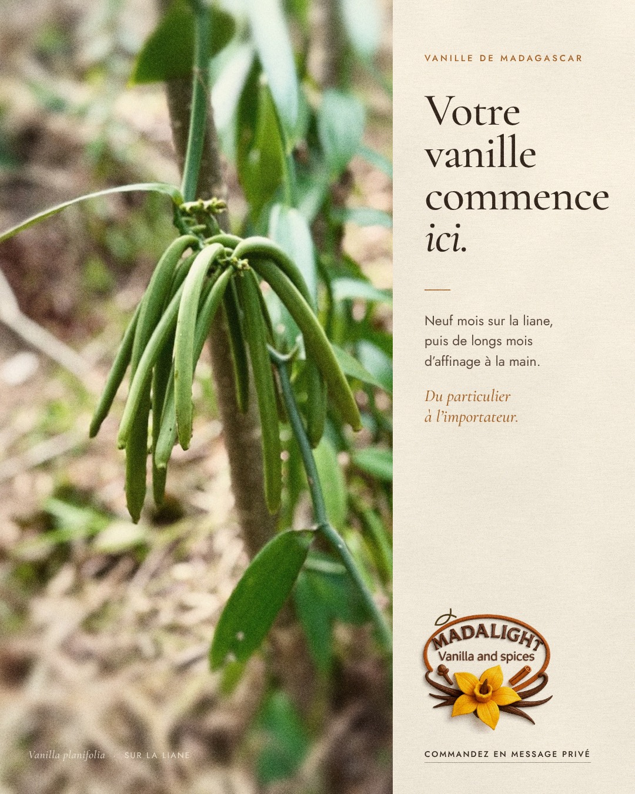
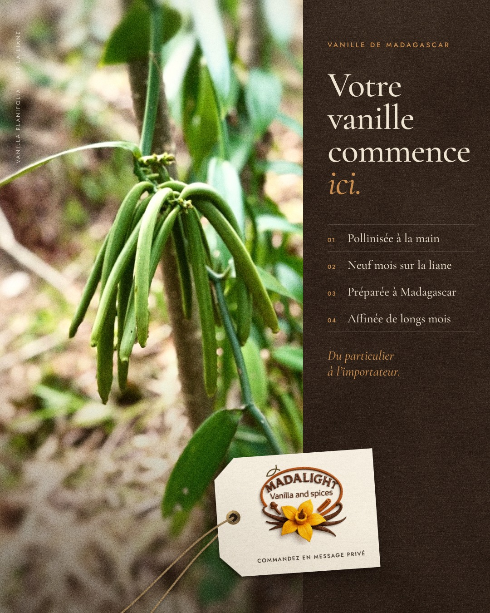
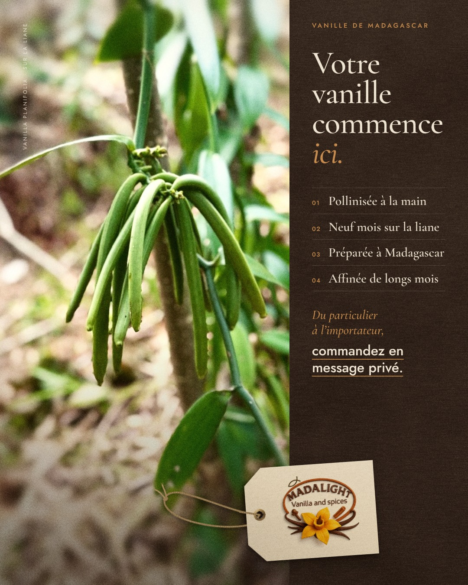

# Publication Facebook — « Votre vanille commence ici »

**Version à publier : v3** (`export/madalight-facebook-v3-1080x1350.jpg`).

| v1 — claire, minimale | v2 — sombre, en profondeur | v3 — v2 corrigée après contrôle qualité |
|---|---|---|
|  |  |  |

Format 4:5 (1080 × 1350 px), celui qui occupe le plus de place dans le fil
Facebook sur mobile. Chaque version existe en JPEG (à publier) et en PNG
(sans perte, pour l'archive) dans `export/`.

## Textes de la publication

Post principal, version courte pour la publicité, version pour les
professionnels, réponse automatique Messenger et conseils de diffusion :
voir [`publication.md`](publication.md).

## Choix de design

- **Grille** : la photo occupe 668 px de large (1080 / nombre d'or), le texte
  les 412 px restants. La grappe de gousses tombe sur la ligne du tiers
  gauche, et l'attache des gousses sur le tiers haut.
- **Lecture** : photo, puis titre, puis texte, puis signature. Le logo et
  l'appel à l'action ferment la lecture en bas à droite. Le vide entre le
  texte et le logo est voulu.
- **Couleurs** : crème papier, brun de gousse affinée et ocre repris du logo.
  Le vert vient uniquement de la photo.
- **Typographie** : Cormorant Garamond pour le titre, Jost pour le texte
  courant (polices libres, licence OFL).
- **Photo** : verts ramenés vers la sauge, tons chauds, noirs relevés (pas de
  noir pur), flou progressif autour des gousses pour les détacher du sol et
  léger grain argentique.
- **Matière** : papier crème avec fibres et grain. Le grain recouvre toute
  l'affiche, texte compris, pour que rien ne paraisse collé dessus.
- **Logo** : détouré sur fond transparent, sans le filigrane « ✦ » du
  fichier d'origine.

### Ce que la v2 ajoute

- **Contraste** : colonne brun gousse affinée, texte crème, photo plus dense
  (ombres profondes sans noir pur, gousses légèrement éclaircies).
- **Profondeur** : le logo est imprimé sur une étiquette en papier à œillet de
  laiton, nouée de raphia comme une botte de vanille. Elle est posée à cheval
  sur la photo et la colonne, ce qui casse la grille et relie les deux moitiés.
  Son ombre tombe en bas à gauche, à l'opposé de la lumière.
- **Contenu** : quatre étapes numérotées, comme sur une fiche de dégustation
  (pollinisation, maturation, préparation, affinage). Elles donnent du crédit
  auprès des acheteurs professionnels.

### Corrections de la v3 (contrôle qualité de la v2)

| Problème relevé sur la v2 | Correction dans la v3 |
|---|---|
| Appel à l'action illisible sur téléphone (12 px, soit 4,3 px à l'écran) | Sorti de l'étiquette et passé à 32 px (11,6 px à l'écran), souligné en ocre. Il forme une seule phrase avec la cible : « Du particulier à l'importateur, commandez en message privé. » |
| L'étiquette est la zone la plus claire et concurrence le titre (luminosité 197) | Étiquette plus petite, papier plus chaud (luminosité 164), débord ⅓ sur la photo et ⅔ sur la colonne. |
| Ficelle trop régulière, qui entraîne l'œil hors du cadre | Boucle nouée, torsion irrégulière, pointe tournée vers les gousses. |
| Étapes à la limite de la lisibilité sur mobile | 30 px en graisse 600 (10,8 px à l'écran). |
| Marges sans système | Une seule marge extérieure de 52 px (haut, droite, bas, légende). |
| Texture du fond brun invisible, grain risqué à la compression | Texture renforcée et grain réduit. À vérifier lors d'une vraie publication. |

Encore ouvert : une ligne d'offre (types de gousses, quantités, export) qui attend
les informations du client, et la validation des quatre étapes.

## Régénérer

```bash
python communication/facebook-liane/prepare.py   # photo, logo, textures
node communication/facebook-liane/render.mjs     # exports PNG et JPEG des trois versions (Playwright)
```

Le texte et la mise en page se modifient dans `affiche.html` (v1), `affiche-v2.html` (v2) et `affiche-v3.html` (v3).
